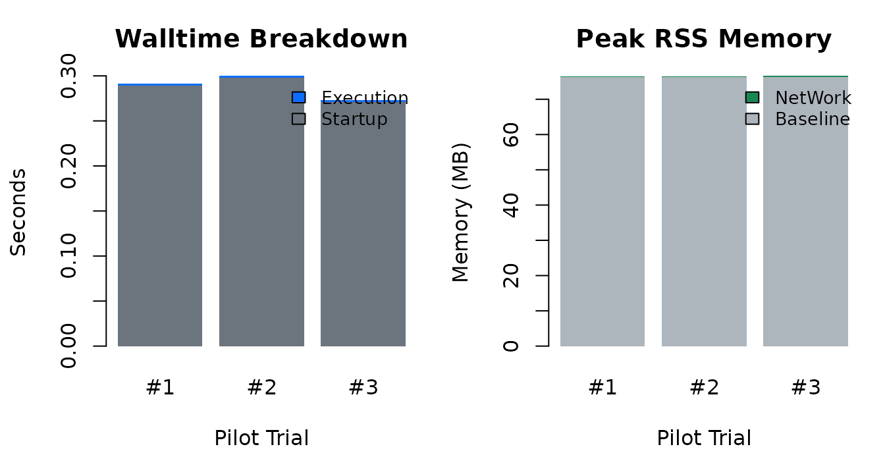

# From Micro-Pilot Profiling to Load-Balanced SLURM Arrays

## Overview

Real statistical computing jobs rarely have uniform, symmetric runtimes.
Parameter grids often sweep sample sizes from small to large, and
iterative estimators (MCMC, mixed models, optimization) produce strongly
right-skewed runtime tails. This vignette covers three pillars of
accurate HPC sizing in `slurmpilot`:

1.  Empirical OS-level RSS and runtime profiling with
    [`pilot_run()`](https://marcusharrisphd.com/slurmpilot/reference/pilot_run.md).
2.  Tail-safe walltime scaling for skewed/heavy-tailed workloads in
    [`estimate_resources()`](https://marcusharrisphd.com/slurmpilot/reference/estimate_resources.md).
3.  Heterogeneous chunk load balancing (`contiguous`, `round_robin`, and
    Longest Processing Time first `lpt`) plus pre-submit closure
    auditing with
    [`inspect_job_globals()`](https://marcusharrisphd.com/slurmpilot/reference/inspect_job_globals.md).

## 1. Empirical Micro-Pilot Profiling

[`pilot_run()`](https://marcusharrisphd.com/slurmpilot/reference/pilot_run.md)
runs sample replications in isolated background child processes
(`isolate = TRUE`) while polling OS process-tree RSS via `ps`. Using
`sample_method = "stratified"` samples evenly across an ordered
parameter grid so both inexpensive and expensive cells are profiled:

``` r

library(slurmpilot)

grid <- lapply(seq_len(12L), function(i) {
  list(task_id = i, n = 100L + 50L * i, reps = 30L)
})

sim_worker <- function(cfg) {
  vals <- replicate(cfg$reps, mean(stats::rnorm(cfg$n)))
  data.frame(task_id = cfg$task_id, n = cfg$n, est_se = stats::sd(vals))
}

pilot <- pilot_run(
  fun = sim_worker,
  args_list = grid,
  n_pilot = 3L,
  sample_method = "stratified",
  seed = 101L
)

print(pilot)
#> 
#> ── slurmpilot Micro-Pilot Profile
#> • Trials: 3/3 succeeded (isolated=TRUE, cpus=1)
#> • Task exec time: median 0.002s, p90 0.002s, max 0.002s
#> • Worker startup: median 0.289s
#> • Memory (RSS): baseline 76.3 MB, peak max 76.6 MB, net max 0.4 MB
summary(pilot)
#> # A tibble: 13 × 2
#>    metric                    value
#>    <chr>                     <dbl>
#>  1 n_trials                3      
#>  2 n_ok                    3      
#>  3 n_failed                0      
#>  4 startup_median_sec      0.289  
#>  5 exec_mean_sec           0.00200
#>  6 exec_sd_sec             0      
#>  7 exec_q50_sec            0.00200
#>  8 exec_q90_sec            0.00200
#>  9 exec_q95_sec            0.00200
#> 10 exec_max_sec            0.00200
#> 11 baseline_rss_median_mb 76.3    
#> 12 peak_rss_max_mb        76.6    
#> 13 net_rss_max_mb          0.352
plot(pilot, engine = "base")
```



## 2. Heavy-Tailed & Skewed Runtime Scaling

When pilot runtimes exhibit right skew (for instance, an MCMC chain or
optimizer where 4 trials take ~1 second and 1 trial takes 40 seconds), a
naive normal Central Limit Theorem (CLT) bound underestimates upper-tail
chunk walltime.
[`estimate_resources()`](https://marcusharrisphd.com/slurmpilot/reference/estimate_resources.md)
evaluates a robust three-model envelope:

``` math
T_{\text{pred}}(k) = \hat{t}_0 + \max\!\left(Q^{\text{CLT}}(k),\; Q^{\text{LogNormal}}_{0.99}(k),\; Q^{\text{Nonparametric}}(k)\right)
```

combining normal CLT, a Fenton-Wilkinson log-normal sum approximation,
and a nonparametric order-statistic bound. Here we demonstrate how the
scaling model detects heavy tails and protects `--time` automatically:

``` r

skew_trials <- tibble::tibble(
  trial_id = 1:5,
  task_index = 1:5,
  status = rep("OK", 5),
  wall_sec = c(3.0, 3.2, 3.1, 3.3, 42.0),
  startup_sec = rep(2.0, 5),
  exec_sec = c(1.0, 1.2, 1.1, 1.3, 40.0),
  baseline_rss_mb = rep(110, 5),
  peak_rss_mb = c(240, 260, 255, 270, 390),
  net_rss_mb = c(130, 150, 145, 160, 280),
  cpu_user_sec = c(1.0, 1.2, 1.1, 1.3, 39.5),
  cpu_sys_sec = rep(0.1, 5),
  n_samples = rep(12L, 5),
  result_size_bytes = rep(1024, 5),
  error = rep(NA_character_, 5)
)

skew_pilot <- structure(
  list(
    trials = skew_trials,
    summary = list(
      n_trials = 5L, n_ok = 5L, n_failed = 0L, n_timeout = 0L, n_oom_suspect = 0L,
      failure_rate = 0, exec_mean_sec = mean(skew_trials$exec_sec),
      exec_sd_sec = stats::sd(skew_trials$exec_sec),
      exec_q50_sec = stats::median(skew_trials$exec_sec),
      exec_q90_sec = stats::quantile(skew_trials$exec_sec, 0.90, names = FALSE),
      startup_median_sec = 2.0, baseline_rss_median_mb = 110,
      peak_rss_max_mb = 390, net_rss_max_mb = 280
    ),
    meta = list(n_pilot = 5L, n_total_hint = 100L, cpus_per_task = 1L, isolate = TRUE)
  ),
  class = "slurmpilot_pilot"
)

res_skew <- estimate_resources(
  skew_pilot,
  n_tasks = 100L,
  max_chunk_size = 5L,
  partition = "general"
)
print(res_skew)
#> 
#> ── slurmpilot SLURM Resource Plan
#> • Workload: 100 tasks -> 20 array chunks (5 tasks/chunk)
#> • SLURM flags: --array=1-20 --cpus-per-task=1 --mem=768M --time=00:30:00
#>   --partition=general
#> ℹ Predicted chunk walltime: 1002.0s (expected 46.6s, startup overhead 4.3%)
#> ℹ Predicted peak RSS: 435.3 MB -> requested 768M
#> ℹ Estimated total compute: 0.26 CPU-hours
res_skew$estimates[c("dominant_model", "is_heavy_tailed", "pred_clt_sec", "pred_lognormal_sec", "pred_nonparametric_sec")]
#> $dominant_model
#> [1] "lognormal"
#> 
#> $is_heavy_tailed
#> [1] TRUE
#> 
#> $pred_clt_sec
#> [1] 182.5778
#> 
#> $pred_lognormal_sec
#> [1] 1002
#> 
#> $pred_nonparametric_sec
#> [1] 163.3
```

## 3. Heterogeneous Load Balancing: Contiguous vs Round-Robin vs LPT

When tasks vary widely in cost (for example, sample sizes or MCMC chain
lengths spanning an order of magnitude), contiguous slicing packs all
expensive tasks into the final chunk, creating a single straggler that
stalls the array job.

Compare
[`plan_chunks()`](https://marcusharrisphd.com/slurmpilot/reference/plan_chunks.md)
across `"contiguous"`, `"round_robin"`, and `"lpt"` (Longest Processing
Time first greedy makespan minimization):

``` r

task_costs <- c(10, 12, 15, 20, 25, 30, 50, 60, 80, 95, 110, 130)

p_contig <- plan_chunks(length(task_costs), chunk_size = 3L, strategy = "contiguous", task_weights = task_costs)
p_rr     <- plan_chunks(length(task_costs), chunk_size = 3L, strategy = "round_robin", task_weights = task_costs)
p_lpt    <- plan_chunks(length(task_costs), chunk_size = 3L, strategy = "lpt", task_weights = task_costs)

comparison <- data.frame(
  strategy = c("contiguous", "round_robin", "lpt"),
  max_chunk_cost = c(
    max(p_contig$estimated_weight),
    max(p_rr$estimated_weight),
    max(p_lpt$estimated_weight)
  ),
  imbalance_ratio = round(c(
    max(p_contig$estimated_weight) / mean(p_contig$estimated_weight),
    max(p_rr$estimated_weight) / mean(p_rr$estimated_weight),
    max(p_lpt$estimated_weight) / mean(p_lpt$estimated_weight)
  ), 3)
)
print(comparison)
#>      strategy max_chunk_cost imbalance_ratio
#> 1  contiguous            335           2.104
#> 2 round_robin            210           1.319
#> 3         lpt            165           1.036
```

Execute an LPT-balanced array job locally and verify that
[`slurm_collect()`](https://marcusharrisphd.com/slurmpilot/reference/slurm_collect.md)
automatically restores exact `1..N` task ordering regardless of chunk
assignment:

``` r

tmp_root <- tempfile("sp_lpt_")
be <- mock_slurm_backend(root_dir = tmp_root, max_workers = 2L)

res_lpt <- resource_spec(
  n_tasks = length(grid),
  chunk_size = 3L,
  mem_mb = 512L,
  time_minutes = 5,
  strategy = "lpt",
  task_weights = task_costs
)

job <- slurm_submit(be, sim_worker, grid, resources = res_lpt, name = "lpt_sim", seed = 77L)
st <- slurm_wait(job, timeout = 30, poll_interval = 0.05)
out <- slurm_collect(job, simplify = TRUE)

stopifnot(identical(out$task_id, seq_len(length(grid))))
head(out)
#> # A tibble: 6 × 3
#>   task_id     n est_se
#>     <int> <int>  <dbl>
#> 1       1   150 0.0913
#> 2       2   200 0.0676
#> 3       3   250 0.0613
#> 4       4   300 0.0591
#> 5       5   350 0.0491
#> 6       6   400 0.0470

unlink(tmp_root, recursive = TRUE)
```

## 4. Pre-Submit Closure & Bundle Diagnostics

Functions created inside another R function inherit that parent frame as
their lexical closure. If a large raw data frame lives in that frame,
`saveRDS(fun)` silently bundles it into every SLURM worker’s
`payload.rds`. Use
[`inspect_job_globals()`](https://marcusharrisphd.com/slurmpilot/reference/inspect_job_globals.md)
to catch accidental closure captures and unresolved free variables
before staging:

``` r

build_leaky_worker <- function() {
  accidental_blob <- numeric(5e5)
  function(x) x + missing_scalar
}

report <- inspect_job_globals(
  fun = build_leaky_worker(),
  args_list = as.list(1:5),
  size_warn_mb = 2
)
print(report)
#> 
#> ── slurmpilot Pre-Submit Globals & Bundle Audit [2 warning(s)]
#> • Estimated payload size: 3.82 MB (closure=3.81 MB, globals=0.00 MB, args=0.00
#>   MB)
#> • Captured local closure objects: 1 | Explicit globals: 0
#> • Unresolved variables: 1 | Unexported functions: 0
#> ! Worker closure captures large local object(s) >= 2.0 MB: accidental_blob (3.8
#>   MB). Consider setting environment(fun) <- globalenv() and passing only
#>   required objects via globals.
#> ! Unresolved free variable(s) referenced in fun: missing_scalar. Pass them
#>   explicitly via globals = list(...).
```
