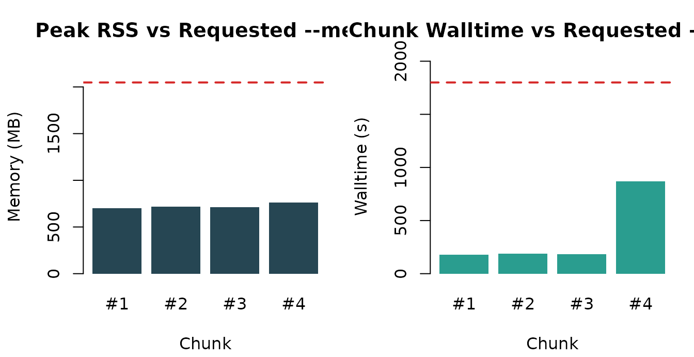

# Multi-Stage HPC Pipelines, Efficiency Auditing & Container Handoff

## Overview

Production computational statistics workflows rarely stop at a single
isolated array job. Researchers commonly run **multi-stage dependent
pipelines** (for example, simulate across parallel array chunks, branch
into independent summary or diagnostic stages, and fan-in into a final
synthesis table), audit cluster efficiency post-mortem to tighten future
SLURM requests, and attach reproducible Apptainer containers produced by
external tools such as `rcapsule`.

This vignette demonstrates all three workflows introduced in
`slurmpilot 0.4.0`.

## 1. Multi-Stage Dependent Job DAGs (`slurm_pipeline()`)

[`slurm_stage()`](https://marcusharrisphd.com/slurmpilot/reference/slurm_stage.md)
and
[`slurm_pipeline()`](https://marcusharrisphd.com/slurmpilot/reference/slurm_pipeline.md)
assemble dependent array stages into a directed acyclic graph (DAG),
automatically validating unique names, upstream references, and
acyclicity via Kahn’s topological sort.

Below we construct a four-stage **diamond DAG**: - `simulate` (root):
runs 8 parallel Monte Carlo estimation tasks. - `power_summary` (branch
A): dynamically consumes `simulate` outputs via `args_from_upstream` to
compute chunk-level rejection indicators. - `bias_summary` (branch B):
computes bias summaries across the simulated estimates using
`.upstream$simulate`. - `synthesize` (fan-in sink): waits for BOTH
`power_summary` and `bias_summary` (`afterok`) and combines them into a
final summary record.

``` r

library(slurmpilot)

s_sim <- slurm_stage(
  name = "simulate",
  fun = function(cfg) {
    x <- stats::rnorm(cfg$n, mean = cfg$delta, sd = 1)
    tt <- stats::t.test(x, mu = 0)
    data.frame(
      task_id = cfg$task_id,
      est = mean(x),
      reject = tt$p.value < 0.05
    )
  },
  args_list = lapply(seq_len(8L), function(i) list(task_id = i, n = 40L, delta = 0.4)),
  resources = resource_spec(n_tasks = 8L, chunk_size = 4L, mem_mb = 512L, time_minutes = 5),
  seed = 2026L
)

s_power <- slurm_stage(
  name = "power_summary",
  fun = function(row_df) mean(row_df$reject),
  args_from_upstream = function(up) split(up$simulate, up$simulate$task_id <= 4L),
  depends_on = "simulate"
)

s_bias <- slurm_stage(
  name = "bias_summary",
  fun = function(target_delta) mean(.upstream$simulate$est) - target_delta,
  args_list = list(0.4),
  depends_on = "simulate"
)

s_final <- slurm_stage(
  name = "synthesize",
  fun = function(up) {
    data.frame(
      empirical_power = mean(up$power_summary),
      mean_bias = mean(up$bias_summary)
    )
  },
  depends_on = c("power_summary", "bias_summary")
)

pipe <- slurm_pipeline(s_sim, s_power, s_bias, s_final, name = "mc_diamond")
print(pipe)
#> 
#> ── slurmpilot Pipeline DAG: mc_diamond
#> • Stages: 4 | Edges: 4 | Roots: simulate | Sinks: synthesize
#> • Topological order: simulate -> power_summary -> bias_summary -> synthesize
```

Execute the entire diamond DAG locally on `MockSlurmBackend` (capped at
2 workers) and inspect live stage status and final collected results:

``` r

tmp_dag <- tempfile("sp_dag_")
be_local <- mock_slurm_backend(root_dir = tmp_dag, max_workers = 2L)

run <- slurm_pipeline_run(pipe, be_local, wait = TRUE, poll_interval = 0.05)
print(slurm_pipeline_status(run))
#> 
#> ── slurmpilot Pipeline Status: mc_diamond [COMPLETED]
#> • Stages completed: 4/4 (running=0, pending=0, failed=0, skipped=0)
slurm_pipeline_status(run)$stages[, c("stage", "level", "state", "n_chunks")]
#> # A tibble: 4 × 4
#>   stage         level state     n_chunks
#>   <chr>         <int> <chr>        <int>
#> 1 simulate          1 COMPLETED        2
#> 2 power_summary     2 COMPLETED        1
#> 3 bias_summary      2 COMPLETED        1
#> 4 synthesize        3 COMPLETED        1

slurm_pipeline_collect(run, simplify = TRUE)
#> # A tibble: 1 × 2
#>   empirical_power mean_bias
#>             <dbl>     <dbl>
#> 1            0.75    0.0204
```

### Queued Cluster-Side SLURM `--dependency=afterok:...` Submission

On `SlurmSshBackend` with `wait = FALSE`,
[`slurm_pipeline_run()`](https://marcusharrisphd.com/slurmpilot/reference/slurm_pipeline_run.md)
submits static stages in topological order and emits genuine
`#SBATCH --dependency=afterok:...` directives so SLURM schedules
downstream stages automatically on the cluster:

``` r

tmp_ssh <- tempfile("sp_ssh_dag_")
job_counter <- 7000L
mock_ssh_runner <- function(cmd, args) {
  if (cmd == "ssh" && grepl("^sbatch ", args[[length(args)]])) {
    job_counter <<- job_counter + 1L
    return(list(status = 0L, stdout = paste0(job_counter, "\n"), stderr = ""))
  }
  list(status = 0L, stdout = "", stderr = "")
}

ssh_be <- slurm_ssh_backend(
  host = "hpc.example.edu",
  user = "researcher",
  remote_dir = "/scratch/researcher/dag_demo",
  local_stage_dir = tmp_ssh,
  command_runner = mock_ssh_runner
)

queued_pipe <- slurm_pipeline(
  slurm_stage("fit_a", fun = function(x) x, args_list = list(1, 2)),
  slurm_stage("fit_b", fun = function(x) x, args_list = list(3, 4)),
  slurm_stage("merge", fun = function(x) x, args_list = list(1), depends_on = c("fit_a", "fit_b")),
  name = "cluster_dag"
)

ssh_run <- slurm_pipeline_run(queued_pipe, ssh_be, wait = FALSE)
ssh_run$dependencies_submitted
#>               fit_a               fit_b               merge 
#>                  NA                  NA "afterok:7001:7002"
grep("^#SBATCH --dependency=", readLines(file.path(ssh_run$jobs$merge$local_dir, "submit.sbatch")), value = TRUE)
#> [1] "#SBATCH --dependency=afterok:7001:7002"
```

## 2. Post-Mortem Resource Efficiency Auditing (`slurm_efficiency_report()`)

After a job finishes,
[`slurm_efficiency_report()`](https://marcusharrisphd.com/slurmpilot/reference/slurm_efficiency_report.md)
compares requested `--mem` and `--time` against empirical Peak RSS and
walltime from `MockSlurmBackend` or parsed `sacct` output. It quantifies
memory waste %, walltime slack %, and straggler imbalance, and emits a
tightened `recommended_resources` spec for your next run:

``` r

# Example 1: Over-provisioned job on MockSlurmBackend
eff_over <- slurm_efficiency_report(run$jobs$simulate)
print(eff_over)
#> 
#> ── slurmpilot Post-Mortem Efficiency Audit: mc_diamond_simulate [over_provisioned]
#> • Memory: 73.6 MB max / 512 MB req (14.4% util, 85.6% waste)
#> • Walltime: 0.1s max / 300s req (0.0% util, 100.0% slack)
#> • Load balance: straggler ratio 1.16x across 2 chunks
#> • Recommended next flags: --array=1-2 --cpus-per-task=1 --mem=256M
#>   --time=00:05:00
#> ℹ Memory waste is 85.6% (peak 73.6 MB vs 512M requested); tighten --mem to
#>   256M.

# Example 2: Imbalanced HPC sacct run with a straggler chunk
sacct_imbalanced <- parse_sacct_output(paste(
  "8100_1|COMPLETED|00:03:00|700M|0:0",
  "8100_2|COMPLETED|00:03:10|720M|0:0",
  "8100_3|COMPLETED|00:03:05|710M|0:0",
  "8100_4|COMPLETED|00:14:30|760M|0:0",
  sep = "\n"
))

eff_sacct <- slurm_efficiency_report(
  sacct_imbalanced,
  resources = resource_spec(n_tasks = 16L, chunk_size = 4L, mem_mb = 2048L, time_minutes = 30)
)
print(eff_sacct)
#> 
#> ── slurmpilot Post-Mortem Efficiency Audit: sacct_job [imbalanced]
#> • Memory: 760.0 MB max / 2048 MB req (37.1% util, 62.9% waste)
#> • Walltime: 870.0s max / 1800s req (48.3% util, 51.7% slack)
#> • Load balance: straggler ratio 4.64x across 4 chunks
#> • Recommended next flags: --array=1-4 --cpus-per-task=1 --mem=1G
#>   --time=00:20:00
#> ℹ Memory waste is 62.9% (peak 760.0 MB vs 2G requested); tighten --mem to 1G.
#> ℹ High straggler ratio (4.64x max/median chunk time); switch to strategy =
#>   'lpt' in estimate_resources()/plan_chunks() to balance chunk loads.
plot(eff_sacct, engine = "base")
```



## 3. Zero-Dependency Container Handoff (`use_rcapsule_container()`)

[`use_rcapsule_container()`](https://marcusharrisphd.com/slurmpilot/reference/use_rcapsule_container.md)
validates container paths and bind mounts safely and attaches Apptainer
`.sif` / `.def` recipes or duck-typed `rcapsule` manifests to any
[`slurm_job_spec()`](https://marcusharrisphd.com/slurmpilot/reference/slurm_job_spec.md)
without introducing a hard package dependency:

``` r

spec <- slurm_job_spec(
  fun = function(x) mean(stats::rnorm(x)),
  args_list = as.list(rep(500L, eff_sacct$recommended_resources$n_tasks)),
  resources = eff_sacct$recommended_resources,
  name = "containerized_run"
)

# Duck-typed rcapsule container manifest
capsule_manifest <- structure(
  list(
    targets = list(
      apptainer = list(
        sif_path = "/scratch/containers/project_env.sif",
        def_path = "/scratch/containers/project_env.def",
        binds = c("/scratch/data:/data:ro")
      )
    ),
    manifest = list(
      content_digest = "sha256:9f86d081884c7d65",
      r_version = "4.4.1"
    )
  ),
  class = "rcapsule"
)

spec_attached <- use_rcapsule_container(spec, capsule_manifest, binds = c("/scratch/out:/out:rw"))
print(spec_attached$container_meta)
#> 
#> ── slurmpilot Container Specification (rcapsule)
#> • Image (.sif): /scratch/containers/project_env.sif
#> • Recipe (.def): /scratch/containers/project_env.def
#> • Binds: /scratch/data:/data:ro, /scratch/out:/out:rw
#> • Provenance digest: sha256:9f86d081884c7d65 | R version: 4.4.1

# Verify generated sbatch includes container execution, binds, and provenance digest
sb <- render_sbatch_script(
  job_name = spec_attached$name,
  resources = spec_attached$resources,
  work_dir = "/scratch/researcher/containerized_run",
  container_sif = spec_attached$container_sif,
  container_binds = spec_attached$container_binds,
  env_vars = spec_attached$env_vars
)
cat(paste(tail(sb$script, 8L), collapse = "\n"), "\n")
#> export APPTAINERENV_MKL_NUM_THREADS=1
#> export APPTAINERENV_SLURMPILOT_WORK_DIR="${WORK_DIR}"
#> export APPTAINERENV_SLURMPILOT_CHUNK_ID="${SLURM_ARRAY_TASK_ID}"
#> export APPTAINERENV_SLURMPILOT_ATTEMPT=1
#> export APPTAINERENV_SLURMPILOT_CONTAINER_DIGEST='sha256:9f86d081884c7d65'
#> 
#> echo "[slurmpilot] Starting job ${SLURM_JOB_ID:-local} array task ${SLURM_ARRAY_TASK_ID} on $(hostname)"
#> apptainer exec --cleanenv --bind '/scratch/researcher/containerized_run:/scratch/researcher/containerized_run' --bind '/scratch/data:/data:ro' --bind '/scratch/out:/out:rw' '/scratch/containers/project_env.sif' Rscript "${WORK_DIR}/worker.R" --work-dir "${WORK_DIR}" --chunk-id "${SLURM_ARRAY_TASK_ID}" --attempt "1"

unlink(c(tmp_dag, tmp_ssh), recursive = TRUE)
```
